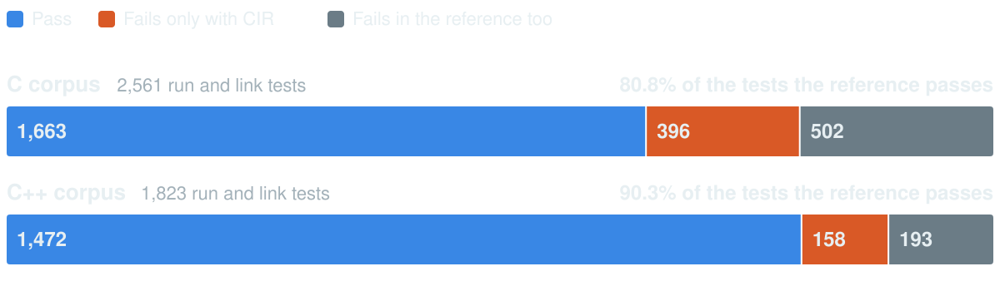

theme: work, 1
title: EDG ClangIR back end: status at M5.1
language: en-US
slidenumbers: true
footer: EDG ClangIR back end · November 2026
slide-transition: fade(0.3)

[.hide-footer]
[.slidenumbers: false]

# [fit] EDG ClangIR back end
## Executive summary: status at milestone M5.1

November 2026 · branch `cir` at c16c2798d2

^ The numbers in this deck come from the M5.1 milestone gate, run on clang4 on 2026-11-06. Every number the charts show is in cir_src/doc/exsum/stats.json; the README there describes how to refresh the deck. The detailed state is in cir_src/doc/project.md, and the requirements are in cir_src/doc/brief.md.

---

# At a glance

[.column]
# 80.8%
C pass rate

# 90.3%
C++ pass rate

[.column]
# 0
back-end crashes in 30,201 compiles

# 1.00×
clang's instructions on 9 kernels

[.column]
# 6 of 15
real-world units compile

# 37 of 39
gate steps pass

^ The pass rates count only the tests that the reference passes. The reference runs the same tests through EDG's established back end: C generation plus gcc. Raw pass rates are 64.9% (C) and 80.7% (C++); both corpora together pass 85.0% of the tests the reference passes. The two gate steps that do not pass are assembly-diff steps; they flag intended output changes, all of them attributed.

---

[.autoscale: true]

# The short version

- **C and standard C++ compile to x86-64 through ClangIR and LLVM.** Neither C nor gcc is in the code generation path.
- **Milestones R to M5.1 are done** (Oct 9 to Nov 6). M6 and M7 remain.
- **Failures are diagnosed, not miscompiled** (93%). Most are GNU or target extensions, which come later.
- **Biggest gaps:** three builtins that block libstdc++ and Boost headers, and no debug info.
- **Next:** review M5.1, answer four questions, plan M6.

^ gcc still assembles and links. M6 is the remaining gaps and the documentation; M7 is release and platforms. The brief puts GNU and MSVC extensions after standard C++.

---

# Milestones

| Milestone | Dates (2026) | What it delivered | Status |
| --- | --- | --- | --- |
| R, M0, M1 | Oct 9 | Design, the ECIL format, `BACK_END_TYPE`, `cpfe-cir`, skeletons | done |
| M2 | Oct 10 | A C subset compiles and runs | done |
| M3 | Oct 10–12 | Core C++: classes, templates, structors, linkage | done |
| M4 | Oct 12–19 | Virtual functions, RTTI, exceptions, member pointers; `-O` levels | done |
| M5, M5.1 | Oct 19 – Nov 6 | Compile speed, bounded memory, optimization attributes, mangling | done |
| M6 | next | Remaining gaps, user and developer documentation | not planned yet |
| M7 | later | Release configuration, Microsoft mode, Windows, other targets | later |
| Extensions | after M7 | GNU extensions, then MSVC extensions | later |

^ Each milestone ended with a reviewed gate commit on the local branch cir. The branch has never been pushed.

---

[.autoscale: true]

# How it works

`front end → writer → ECIL stream → library → ClangIR → LLVM → x86-64`

[.column]
### The writer
`src/ecil_*`, about 25K lines.

Streams each function out as soon as the front end is done with it.

[.column]
### The library
`cir_src/`, about 36K lines of C++17.

Builds ClangIR. Front-end changes do not rebuild it.

[.column]
### Scope today
x86-64 Linux, libstdc++.

In-process, or a second process that reads an `.ecil` file.

^ ClangIR (CIR) is the MLIR dialect behind upstream clang's new code generator. The CIR back end hands it EDG's C++ IL without lowering it to C. ECIL is the purpose-built stream format between the writer and the library. The target ABIs are SysV and Itanium. The library tracks a pinned upstream llvm-project commit with no local patches.

---

# Test pass rates

Both corpora together: **85.0%** of the tests the reference passes (3,135 of 3,689).

^ The corpora are the run and link tests of the GNU C and C++ testsuites (imported/gnu). The C++ corpus also includes EDG's own run tests (edg/ and cwg/). A test that also fails in the reference fails for a reason outside the CIR back end, usually a front-end limit or the test environment. Raw pass rates: C 1,663 of 2,561 (64.9%), C++ 1,472 of 1,823 (80.7%), both 3,135 of 4,384 (71.5%).

---

# Other test results

[.column]
# 100%
of the smoke, regression and unit suites

[.column]
# 70 of 70
link-and-run mixes with g++, and with clang

[.column]
# 45,434
front-end regression tests per configuration: unchanged

^ Suites: C smoke 40/40, C++ smoke 98/98, CIR regression suite 266/266, library unit tests 231/231, with the same results in-process and two-process. ABI: objects compiled by CIR link and run with objects compiled by g++ (70 of 70) and by clang (70 of 70). Existing product: the regression run is identical in four 64-bit and 32-bit configurations, and preprocessed output of non-CIR builds is identical (720 files). No test went from pass to fail since M5. Gate: 37 of 39 steps pass; the two assembly-diff steps flag intended changes from M5.1's always_inline handling at -O0 and from mangling fixes, whose names now match g++ 15.

---

# Why tests still fail

^ Only the failures whose test passes in the reference: 396 in C and 158 in C++. Every row except the last is a diagnosed drop: the back end names the construct and drops the function. The last row is 22 link errors and 4 wrong results in C, and 6 link errors, 3 wrong results and 1 front-end diagnostic in C++. All 7 wrong results are known. 19 of the 22 C link errors are tests that expect the optimizer to remove a call to an undefined link_error function. About 42 C++ tests (under 3% of the 1,630 the reference passes) fail on a standard C++ construct; in C, the standard gaps are mainly _Complex, VLAs and _BitInt.

---

# Performance and code quality

[.column]
# 1.00×
clang's instructions on 9 kernels; code size 1.01×

[.column]
# 26–62%
of the pre-M5 library cost on real-world units

[.column]
# 52%
peak memory with chunked lowering, 12,000-function unit

^ Kernels: geometric mean against clang; the tenth kernel, sort, does not build yet because it needs __builtin_constant_p. Compile cost is the library's instruction count against the M5a baseline; lazy emission made the cut. On a generated 6,000-function C++ unit it is 91.6% (target 92%). Memory: 404 MB chunked against 780 MB unchunked; functions also stream out of the front end as soon as they are finished. The optimization attributes we emit match clangir's on the checked set, with 0 unexplained differences.

---

[.autoscale: true]

# Biggest missing pieces

1. **Builtins that block real code.** `__builtin_constant_p`, `__atomic_*` and x86 add-with-carry block libstdc++ algorithms, containers, `<memory>` and `<regex>`, and four Boost libraries. Only 6 of 15 real-world units compile.
2. **Debug info.** None is emitted yet.
3. **GNU and target extensions.** Vector types, inline assembly, atomics and GNU attributes cause most failures. The brief puts them after standard C++.

^ The corpus understates the first gap because its tests rarely include library headers. The four Boost libraries are algorithm, range, format and multiprecision. A ninth unit, Boost container, needs a placement-new form. Chunked lowering will need one debug compile unit per translation unit.

---

[.autoscale: true]

# Other gaps

- **Standard language:** coroutines, namespace-scope `thread_local` with dynamic initialization, C `_Complex`, VLAs, `_BitInt`, rare initializer forms.
- **Platforms:** x86-64 Linux only. AArch64 waits on upstream; Microsoft mode, Windows and macOS are M7.
- **Readiness:** no user or developer docs yet; a few attributes silently ignored.
- **Integration:** branch `cir` is local and not rebased on `main`.

^ Coroutines are not designed yet. AArch64 waits on upstream ClangIR's calling-convention lowering. -fwrapv is an environment variable, not a command-line option. The silently ignored attributes are section, transparent_union and ms_abi. The changelog entries need a GitHub issue before main's checker accepts them. Whether to support _Float16 and _Float128 is undecided. The full gap lists are project.md §4 and writer.md §9.12.

---

[.autoscale: true]

# Next steps

1. **Review M5.1** and answer the four open questions.
2. **Plan M6:** first the housekeeping, then the three builtins.
3. **Then in M6:** debug info, the standard-language gaps, code quality, clang-mode mangling, documentation.
4. **Plan the rebase** onto `main`.
5. **Then M7**, then the GNU and MSVC extensions.

^ The housekeeping: move the gate baselines to the M5.1 set and close the M5.1 review follow-ups. Track the builtins work by the real-world unit count, 6 of 15 today. Code quality means emitting library calls as llvm.mem* intrinsics and closing the remaining attribute differences. The M6 order is the one project.md §6 proposes; open question 4 asks the user to confirm it.

---

[.autoscale: true]

# Decisions needed

1. **Changelog:** move the older CIR entries to `src/pending_changes/`, and pick the GitHub issue that tags them.
2. **Memory ceilings:** tighten the C rows of the RSS check to 1.25 × the M5.1 values?
3. **clang4 clean-up:** delete the old trees there, or keep them?
4. **M6 order:** start with `__builtin_constant_p`, or with another item?

^ These are the open questions of project.md §8. The C RSS rows sit at 33–46% of their ceilings, so a 2x regression would still pass. The agents are not allowed to delete trees on clang4.

---

[.autoscale: true]

# Risks

- **Upstream churn:** ClangIR changes fast; every pin bump needs re-checks.
- **Upstream scaling:** some passes are slow on extreme inputs.
- **Unverifiable facts:** a wrong "does not throw" fact silently skips cleanups.
- **Test infrastructure:** one shared x86-64 host; a full gate takes about 3.5 hours.

^ We pin one llvm-project commit with no local patches; the bump re-checks are listed in project.md §5. Scaling examples: 2,000 nested try blocks take 208 s, and a 160-layer virtual-base diamond takes 31 s and 4.2 GB. The library cannot check the "does not throw" facts the front end sends; they are reviewed whenever the writer changes them.
